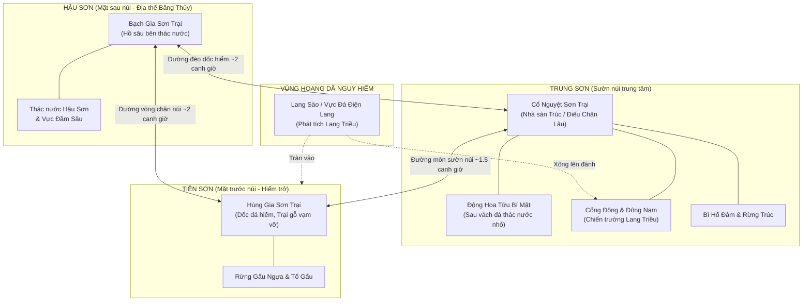

# BẢN ĐỒ KHẢO SÁT THANH MAO SƠN (BẢN ƯỚC LƯỢNG ĐỊA LÝ)
> **Nguồn trích xuất căn cứ:** Văn bản tác phẩm *Cổ Chân Nhân* (File `quyen1.md` - 33.661 dòng)  
> **Nguyên tắc biên soạn:** Trích xuất chính xác 100% các địa danh, mô tả phương vị có trong truyện; kết hợp suy luận logic để ước lượng khoảng cách và bố cục không gian nhằm phục vụ làm dữ liệu cho Game (World Map Chunk Engine).

---

## 1. TỔNG THỂ HÌNH THẾ THANH MAO SƠN

Thanh Mao Sơn là một đại sơn mạch độc lập tại vùng Nam Cương, quanh năm cây cối xanh tươi, mưa xuân liên miên và mùa đông có tuyết phủ. Địa thế núi dốc, rừng rậm rạp, suối ngầm và khe nứt nham thạch chằng chịt.

Trong văn bản nguyên tác, bố cục quyền lực và địa lý tổng thể được xác định rõ ràng tại **Dòng 9593**:
> *"Thanh Mao sơn có tam đại sơn trại, phân biệt là Cổ Nguyệt sơn trại, Hùng gia trại, Bạch gia trại. Trong đó Hùng gia trại ở phía trước núi (tiền sơn), Cổ Nguyệt sơn trại ở sườn núi (trung sơn), Bạch gia trại ở phía sau sơn thác nước (hậu sơn bộc bố)."*

Lộ trình di chuyển vòng quanh núi của Thương đội Cổ Phú (**Dòng 6369**):
$$\text{Cổ Nguyệt Sơn Trại} \longrightarrow \text{Hùng Gia Trại} \longrightarrow \text{Bạch Gia Trại} \longrightarrow \text{Rời núi}$$

---

## 2. SƠ ĐỒ BẢN ĐỒ TỔNG THỂ (MERMAID DIAGRAM)

---

## 3. PHÂN VÙNG ĐỊA LÝ CHI TIẾT (WORLD CHUNKS)

### CHUNK 1: CỔ NGUYỆT SƠN TRẠI (SƯỜN NÚI - TRUNG TÂM)
* **Vị trí:** Tọa lạc tại sườn núi (trung sơn), nhìn xuống chân núi, địa thế thoai thoải nhiều đồi trúc xanh.
* **Quy mô kiến trúc:** Hàng ngàn ngôi nhà sàn treo cẳng cao bằng gỗ trúc (**Điếu chân lâu**), ban đêm thắp đèn sáng rực rỡ như dải lụa quang bao bọc sườn núi (Dòng 67-71).
* **Các địa điểm nòng cốt nội trại:**
  1. **Gia tộc Từ Đường / Tổ Miếu:** Trung tâm trại, tòa lầu các nguy nga 3 tầng thờ phụng bài vị tổ tiên. Ngầm bên dưới là **Tuyền Nhãn** (nguồn nguyên tuyền sản sinh nguyên thạch của gia tộc) và **Cổ Thất** (kho chứa Cổ trùng giống).
  2. **Học Đường Gia Tộc:** Nơi đào tạo thiếu niên 15 tuổi, có võ đài luyện võ, ký túc xá học đồ, phòng gia lão học đường.
  3. **Quảng Trường Sơn Trại:** Bãi đất trống lớn trung tâm, nơi thương đội Cổ Phú hạ trại buôn bán, dựng lều đổ thạch cờ bạc.
  4. **Khu Phố Buôn Bán & Khách Sạn:** Nơi có tửu quán, quán trọ của gia đình cữu phụ Phương Nguyên, tiệm bán rượu Thanh Trúc Tửu, quầy thịt bò.
  5. **Dược Đường:** Khuôn viên chữa trị thương binh, quản lý kho thảo dược và Sinh Cơ Diệp.
  6. **Hình Đường:** Nơi tra khảo phá án, giam giữ tội phạm tộc nhân.
  7. **Cổng Trại (Đông Môn, Nam Môn...):** Cổng gỗ kiên cố, trồng **Thiết Đằng Cổ** và **Độc Hoa Cổ** ken dày trên tường rào làm chông gai chống thú dữ. Cổng Đông đối diện trực diện với hướng thú triều tràn lên.

---

### CHUNK 2: HỆ THỐNG ĐỘNG NGẦM HOA TỬU (DI SẢN BÍ MẬT)
* **Vị trí:** Nằm bên ngoài sơn trại, ẩn giấu sau một kẽ nứt vách đá cạnh một dòng thác nước nhỏ và bụi hoa dại.
* **Cấu trúc không gian ngầm (từ ngoài vào trong):**
  * **Tầng 1 (Kẽ nứt & Hầm rượu):** Lối vào hẹp chỉ vừa 1 người lách qua, mùi rượu thơm ngát thoang thoảng. Đây là nơi Phương Nguyên bắt được **Tửu Trùng**. Đi sâu vào có một tảng cự thạch chặn ngang đường hầm (yêu cầu sức mạnh 1 trư lực của Bạch Thỉ Cổ để đẩy dịch chuyển).
  * **Tầng 2 (Vách đá Lưu Ảnh & Hố hoa):** Sau tảng đá là đường hầm dốc phát ra ánh sáng đỏ nhạt. Có vách đá lưu ảnh của Hoa Tửu Hành Giả, hố đất chôn **Địa Tàng Hoa Cổ** (chứa Bạch Thỉ Cổ bọ rùa). Phía sau cửa đá tiếp theo là động bùn lầy rễ cây nuôi dưỡng **Cửu Diệp Sinh Cơ Thảo**.
  * **Tầng 3 (Hồ nước ngầm & Thổ đầm):** Hang động rộng lớn có hồ nước ngầm mát lạnh, vách đá ký sinh **Địa Thính Nhục Nhĩ Thảo**. Dưới đáy nước có hốc đá giấu **Tịnh Thủy Cổ** và **Thiên Bồng Cổ**.
  * **Tầng Tận Cùng (Lăng mộ Cổ Nguyệt Sơ Đại):** Đường hầm của Hoa Tửu Hành Giả thực chất đào thẳng vào mật thất sâu nhất của Thủy tổ Cổ Nguyệt. Nơi có kết giới **Thủy Mạc Thiên Hoa / Huyết Mạc Thiên Hoa**, ao máu huyết trì và cỗ quan tài phong ấn của Cổ Nguyệt Sơ Đại.

---

### CHUNK 3: HÙNG GIA SƠN TRẠI (TIỀN SƠN - MẶT TRƯỚC HIỂM TRỞ)
* **Vị trí:** Nằm ở mặt trước núi (tiền sơn), địa hình dốc đá đứng, gồ ghề hiểm trở nhất Thanh Mao Sơn.
* **Đặc điểm:** 
  * Sơn trại xây bằng những thân cây gỗ lim cổ thụ to lớn, thô kệch, kiên cố như pháo đài chiến đấu.
  * Tộc nhân Hùng gia tướng mạo vạm vỡ, lực lưỡng, chuộng sức mạnh cận chiến.
  * Độc quyền sản xuất **Hùng Đảm Tửu** (rượu mật gấu).
  * **Vùng phụ cận (Rừng Gấu):** Rừng rậm rạp nhiều hang hốc tự nhiên, nơi sinh sống của các đàn gấu ngựa hung dữ. Cổ sư Hùng gia dùng **Ngự Hùng Cổ** bắt gấu về thuần hóa làm hộ vệ.

---

### CHUNK 4: BẠCH GIA SƠN TRẠI (HẬU SƠN - VÙNG THÁC NƯỚC BĂNG THỦY)
* **Vị trí:** Nằm ở sườn núi phía sau (hậu sơn), tọa lạc ngay cạnh một thác nước lớn đổ xuống hồ sâu (hồ đàm).
* **Đặc điểm:**
  * Nước non bao bọc, hơi nước và sương mù bốc lên quanh năm khiến nhiệt độ ở đây luôn lạnh hơn hai trại còn lại.
  * Nhà cửa xây bằng đá hoa cương trắng và ngói xám sáng sủa.
  * Cổ sư Bạch gia nhờ khí hậu thác nước ẩm lạnh nên da dẻ trắng trẻo, thiên về tu luyện Thủy đạo và Băng Tuyết đạo.
  * Nổi tiếng với danh tửu **Bạch Lương Dịch**.
  * Thiên tài quái kiệt: Nơi ở của **Bạch Ngưng Băng** (Bắc Minh Băng Phách thể).

---

### CHUNK 5: KHU VỰC HOANG DÃ TRUNG GIAN & VÙNG CHIẾN TRƯỜNG
1. **Bì Hổ Đàm (Đầm Da Hổ):**
   * Vũng đầm lầy trũng giữa sườn núi, nước sâu cỏ rậm, là bãi tắm và uống nước tự nhiên của thú rừng (hổ, heo rừng, hươu nai). Nơi các tiểu tổ cổ sư thường phục kích săn bắn tích điểm học đường.
2. **Lang Sào (Vực Đá Điện Lang):**
   * Nằm ở các khe nứt hiểm trở dưới chân núi hoặc hẻm núi cụt. Nơi bầy **Điện Lang** (sói điện) sinh sôi.
   * Cứ mỗi 3 năm, bầy sói phát triển vượt tầm kiểm soát tạo thành đại họa **Lang Triều**:
     * *Điện Lang thông thường:* Di chuyển theo bầy hàng chục con.
     * *Cuồng Điện Lang:* Thú hoang tương đương Tam chuyển, móng vuốt mang điện.
     * *Lôi Quán Điện Lang:* Thú vương to lớn như voi, đầu đội vương miện sấm sét, chỉ huy toàn bộ đợt sóng thú triều tràn qua các cửa ngõ của ba gia tộc.

---

## 4. BẢNG THAM CHIẾU KHOẢNG CÁCH & THỜI GIAN DI CHUYỂN

| Tuyến đường di chuyển | Địa hình | Thời gian Cổ sư đi bộ | Thời gian Thương đội / Phàm nhân | Nguy cơ chạm trán |
| :--- | :--- | :---: | :---: | :--- |
| **Cổ Nguyệt $\longleftrightarrow$ Hùng Gia** | Men theo sườn đồi dốc, rừng thông | $\approx 1.5$ canh giờ (3 tiếng) | $\approx 0.5$ ngày | Heo rừng, gấu ngựa lang thang |
| **Hùng Gia $\longleftrightarrow$ Bạch Gia** | Đi vòng chân núi, băng qua dốc đá | $\approx 2.0$ canh giờ (4 tiếng) | $\approx 0.5 - 1$ ngày | Vực đá lở, thú hoang ăn thịt |
| **Bạch Gia $\longleftrightarrow$ Cổ Nguyệt** | Băng đèo sau núi, qua hẻm thác nước | $\approx 2.0$ canh giờ (4 tiếng) | $\approx 0.5 - 1$ ngày | Rắn độc, bẫy trượt chân thác nước |
| **Cổ Nguyệt Trại $\longleftrightarrow$ Động Hoa Tửu**| Xuống sườn núi hẻo lánh, vách thác | $\approx 20 - 30$ phút | — | Cổ sư tuần tra gia tộc phát hiện |
| **Trại $\longleftrightarrow$ Cửa hang Điện Lang** | Xuống chân núi, vực sâu rậm rạp | $\approx 1.0$ canh giờ (2 tiếng) | — | Chạm trán thú trinh sát của Lang Triều |

---

## 5. Ý NGHĨA ÁP DỤNG VÀO THIẾT KẾ GAME ENGINE

1. **Cơ chế nạp Chunk động (Dynamic Chunk Loading):**
   * Khi người chơi ở trong Cổ Nguyệt Trại, chỉ cần load dữ liệu NPC nội bộ (Học đường, Gia lão, Quán trọ).
   * Khi người chơi bước ra khỏi cổng trại (Đông môn), Engine chuyển sang load môi trường Hoang dã (tỉ lệ xuất hiện dã lang, heo rừng, thảo dược).
2. **Tuyến thời gian theo mùa & Sự kiện thế giới (World Tick):**
   * **Đầu game (Mùa Xuân):** Hòa bình, thương đội Cổ Phú đến buôn bán, học đường khảo hạch.
   * **Giữa game (Mùa Hạ/Thu):** Căng thẳng gia tăng, thú hoang quấy nhiễu, liên minh 3 trại đàm phán tại sườn núi.
   * **Cuối game (Mùa Đông):** Lang triều bùng nổ toàn diện, bản đồ ngập trong tuyết và xác dã lang, chuyển hóa thành chiến trường phòng thủ cửa trại.
   * **Tàn cuộc Quyển 1:** Bạch Ngưng Băng tự bạo biến toàn bộ bản đồ Thanh Mao Sơn thành vùng đóng băng vĩnh cửu (**Băng Phong Tuyệt Vực**).
